# A11 – Motor Selection

## Objectives
1.) Select a motor and design a motor mount for assembly

2.) Run FEA on vertical and horizontal frame pieces of assembly based on calculated forces

3.) Design a floating bearing for lead screw

4.) Create a bill of material and labor cost sheet

5.) produce drawings and isometric view of assembly

## Analyze
This week's assignment is a continuation of the design and assembly of a tensile tester. This portion will focus on the motor selection to drive the lead screws, frame, mounting, and clamping of the tensile tester.

### Motor Selection & Attachments: Greyson Boatright

#### Motor Selection

When selecting the motor for the tester, it had to meet the requirement of 2kn of force, in total, I broke this up as one motor was responsible for one leadscrew and assuming this force was disturbed equally that mean 1kn for each. From previous calculations the required torque needed to be achieved was 1.019N*m and the range of the screw speed was between 0.63 to 31.5 RPM. It took me a while to find a suitable motor for this project but I ended up going with compact DC gear motor that meet the required values I was looking for according to the product details and speed torque curve.

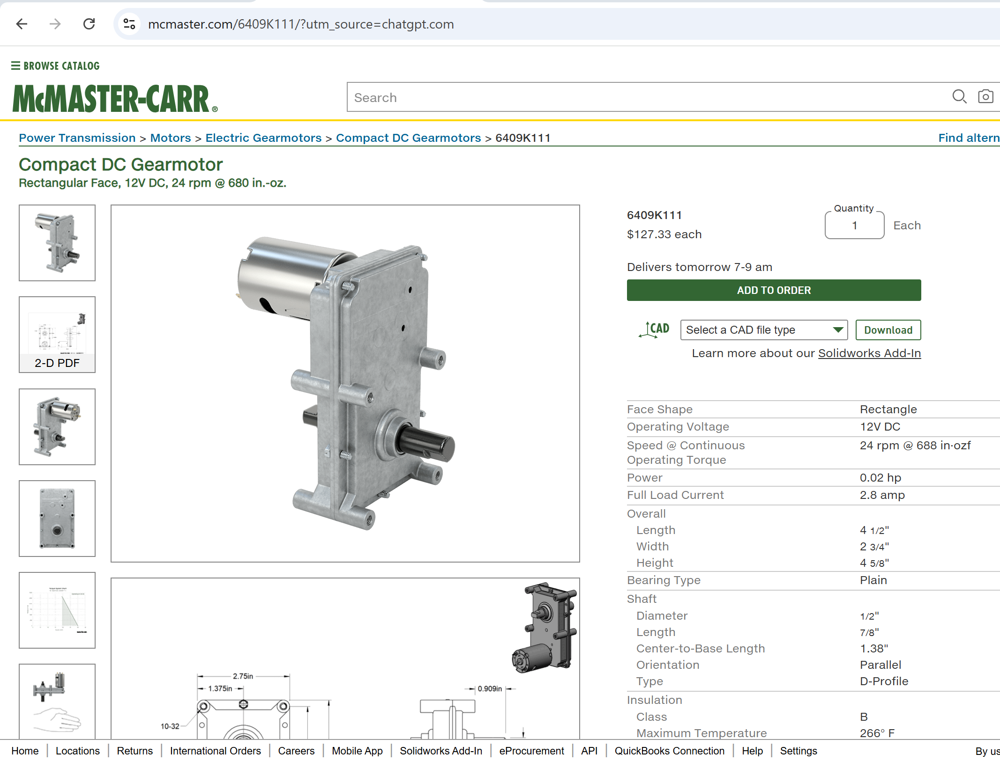
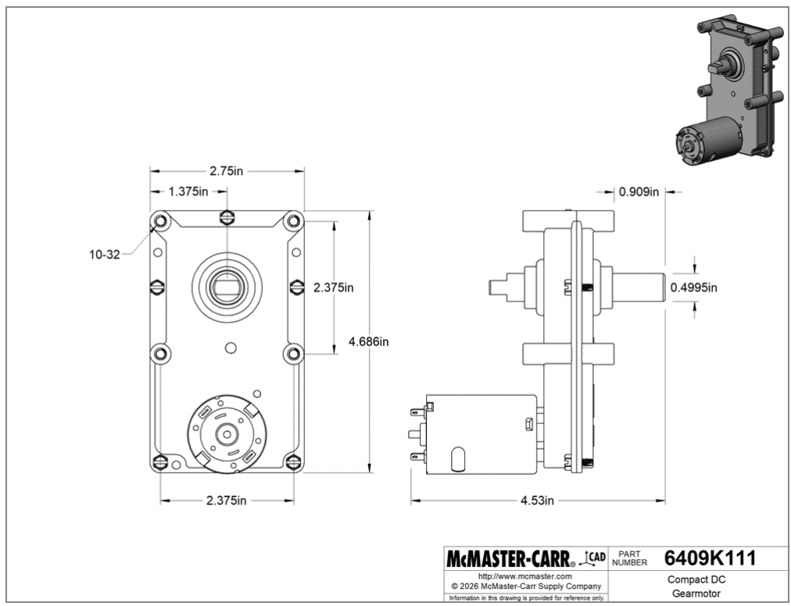
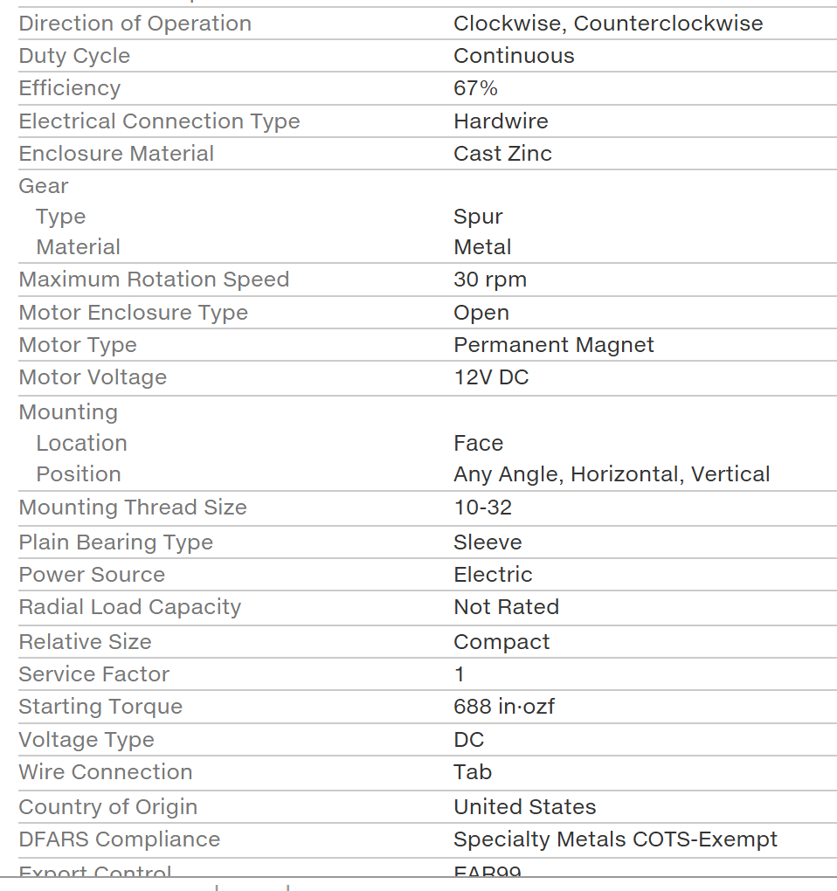
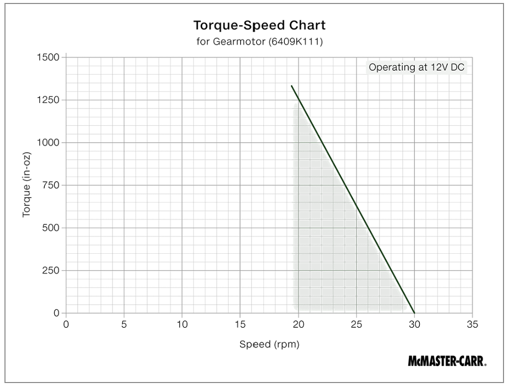

Motor Link(6409K111 at $127.33 each): https://www.mcmaster.com/6409K111/

#### Motor Mount Bracket
The bracket is pretty straight forward, after doing some calculations to find the minimum thickness of 0.071mm I decided to go up to 6.35mm or 0.25in for simplicity. Since the motor could be mounted in a conventional way I created a rectangular plate that would serve as the mount. I created the mount in a rectangular shape and gave the edges a small radius to smooth them out. The hole for the shaft is placed in the center and is large enough for the shaft and the couple. Around the center hole are four holes for the 10-32 screws to attached the bracket to the motor, I utilized the pattern feature on this part to ensure all holes were constrained appropriatly. I repeated the same process for the holes that would attach the mount to the frame of the tester with their respective dimensions. Lastly, I decided to make the mount out of Aluminum since that is the yield strength I did the calculations with.

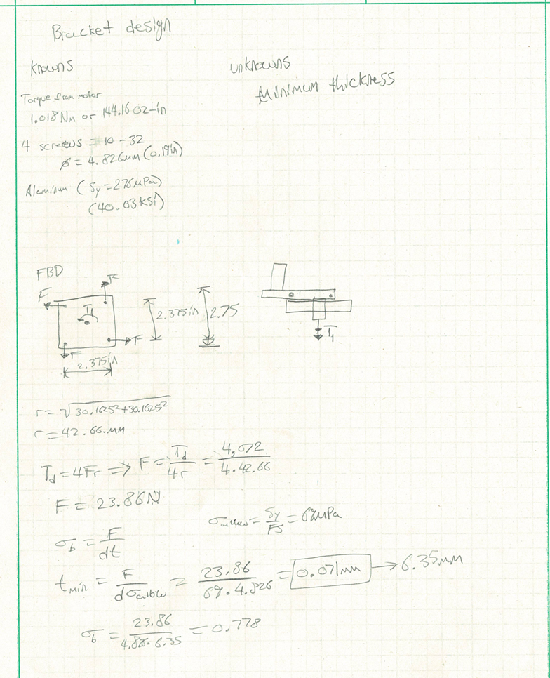
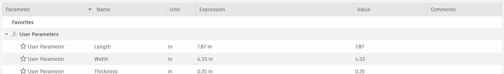
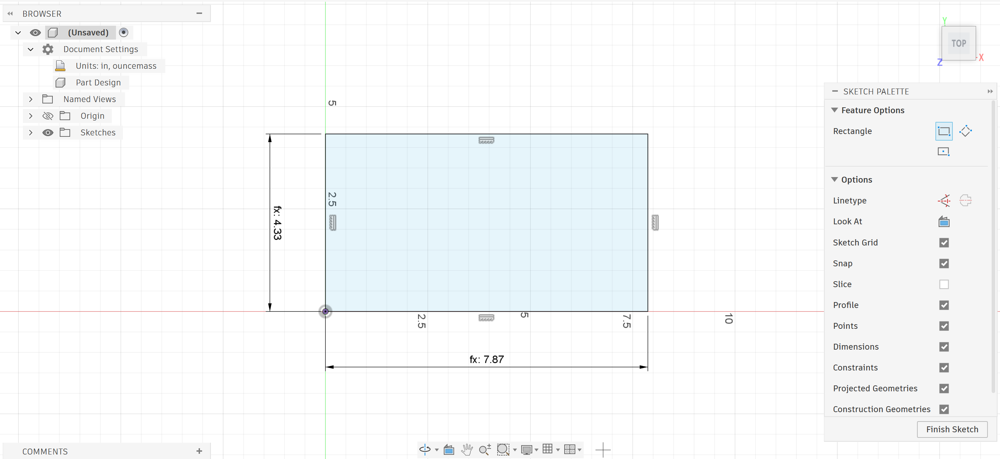
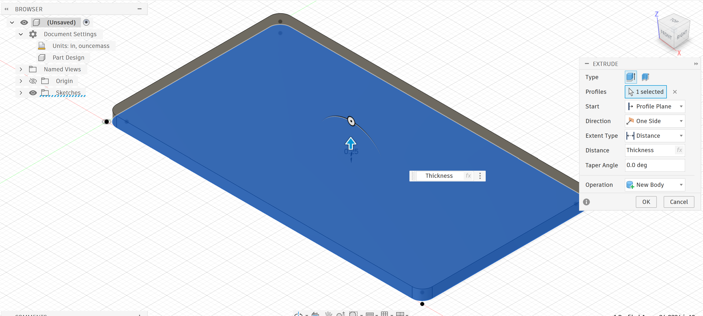
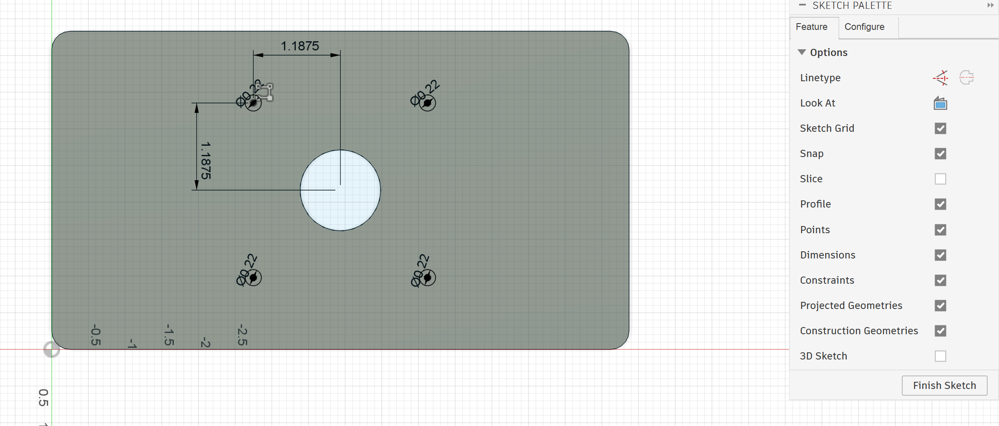
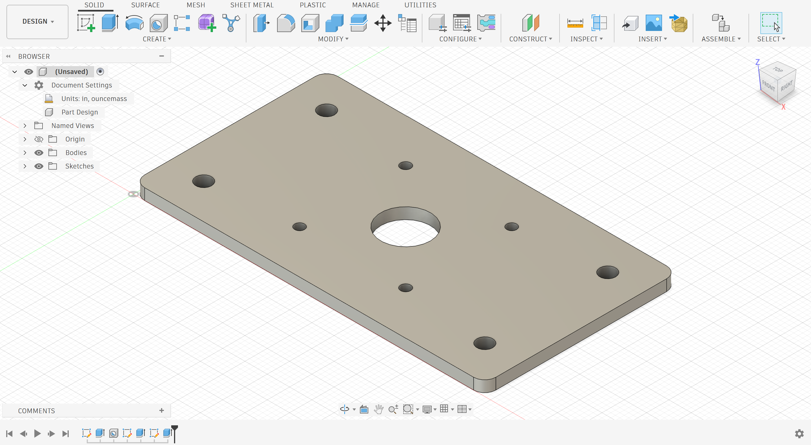
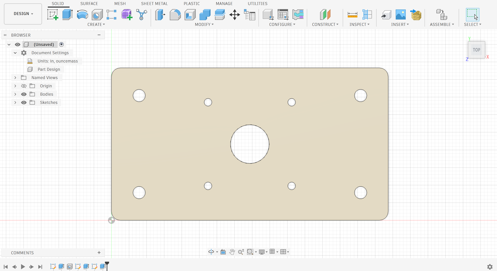

[Download the Motor Mount Bracket](./Motor%20Mount%20A11.f3z)

#### Coupler Selection

For the couple design, I examined the torques in the leadscrew and in the shaft to decide the minimum thickness the couple would need. After drawing a free body diagram I was able to set up an equation for torsional shear stress and solve for the inside diameter. I then found the minimum thickness which was 0.272mm or 0.0107in. I decided to go onto McMaster Carr and select a coupler, I was able to find a coupler assembly, it came with a hub for the motor, a hub for the leadscrew, and a flexible spider that would lock the two together when transferring torque. All of the parts for the coupler and the motor were relatively cost friendly which is one of the factors I tried implement in my analysis.

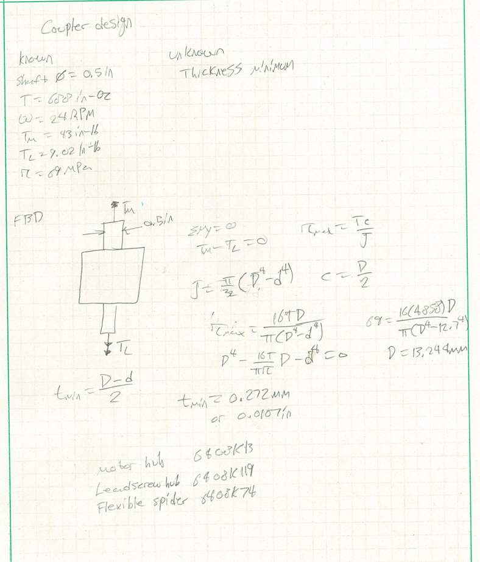
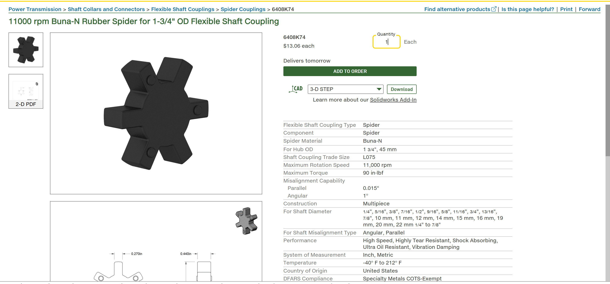
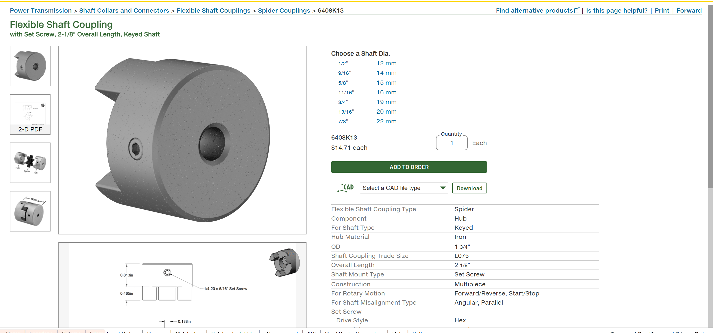
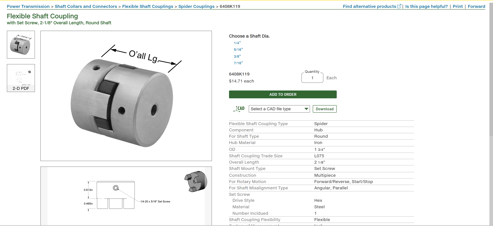

Link for coupler components

Motor Hub(6408k13 at $14.71 each): https://www.mcmaster.com/6408K13/

### Analyzing and Designing the Frame - J.V. Muron

For the design of the frame, the way the frame is assembled is important to how the machine will be affected under load. An FBD of the top bar and vertical runners is conducted to pick the proper fastening technique for the 40 Series bars from the previous assignment.

Looking at the mock-up assembly, there is no clear way to assemble the top piece practically. To solve this issue, the header bar length will be extended **over** the vertical runners and **reorientated** to have the flat side on top of the vertical runners. This orientation allows for the top runner to be calculated as a beam, while also increasing the bending moment, due to the larger cross section. The new length of the top runner is **17.278 inches minimum**. There is extra material so this is not a problem. The new length of the bar will be **18.258 inches**.

#### FBD of Top Bar and Vertical Runners
Treating the top runner as a bar under torsional and transverse load, the reaction forces and design torque and forces can be calculated. The motors will both spin the same direction, so the calculated design torque will be the motor selected torque times two, times the safety factor of 4. This gives a calculated torque that the design must be able to handle. This torque is **38.88 Nm**. Based on the torque from the motors, the force the design needs to be able to withstand is **101.28N**. The counteracting moments from each side of the frame to counteract movement from the motor needs to be **25.32N and -25.32N**. The reaction forces on the frame need to be at least **1000N per side**. 

#### Bracket Selection
The hardware being selected needs to be able to withstand these forces, while also not succumbing to bending or shear failure. To verify the bracket selection, the shear, bearing, and bending stresses of the bracket must be calculated. The first pick of the bracket conflicted with the design and did not mesh with the T slots, so the new pick was **40 Series 76x69x76 mm**. While the slots have 8 bolts to hold everything in, the calculations will be determined using the minimum fastener amount of 4, and extra can be added if needed. This bracket uses 8mm bolt fasteners. Assuming the 101.28 N force is split between two brackets, the shear stress in the bolts is calculated to be **0.252MPa**. The bearing stress on the bracket is calculated from the thickness of the plate (8mm) and diameter of the bolt. This bearing stress is calculated to be **0.198MPa**. The bending stress of the bracket is calculated next. The value calculated comes out to **0.112 MPa**.

Using the yield strength of Aluminum as 276 MPa and the safety factor of 4, all metrics of the bracket are well under the allowed shear and bearing stress. This means the failure mode will not come from the forces on the bracket.

### FEA Top Runner - J.V. Muron

An FEA is conducted on the top bar to ensure it is able to handle the stresses from the motors and tensile forces. To analyze the bar, the split face technique is used again to apply fixed constraints to where the bar would be affixed to the vertical runners.

Next, The torque and tensile forces are loaded to the top of the bar.

The test is now ready to be conducted

#### Iterations and Convergence on Top Runner

##### Iteration 1

Safety Factor: 6.934

Stress: 39.659 MPa inside of lead screw hole

Deflection: 0.001 inches in the center of the bar

##### Iteration 2

Safety Factor: 6.939

Stress: 39.63 MPa inside of lead screw hole 

Deflection: 0.001 inches in center of bar

This design reached convergence after to meshes on all criteria. This implies a strong design already for what the bar is made for. The design showed no unplanned warping or twisting from the applied moments. If there were improvements that would need to be made to the runner, the mounting plate thickness could increase or adding steel plates to increase the stiffness of the frame could be used. 

### FEA on Vertical Supports - J.V. Muron

The vertical support will have an FEA ran on it as well. This has the axial load of 1000 N,  but also a transverse load. This transverse load can be calculated by the moment divided by the distance of the space in between the bars. This comes to **65.96 N**. 

The bottom of the bar is a fixed constraint.

The transverse and axial load are then applied to the bar.

#### Iterations and Convergence of Vertical Runner

##### Iteration 1

Safety Factor: 95.528

Stress: 2.879 on fixed end

Deflection: 0.003 in on transverse load end

##### Iteration 2

Safety Factor: 89.75

Stress: 

Deflection: 

The vertical runner also meets all convergence criteria. These runners will be able to support the transverse and axial loads without buckling.

## Decide

### Design of floating bearing for lead screws - Austin Hill

In order to prevent transverse deflection from buckling in the lead screws, floating bearings were designed.
The fit was assigned to be class RC3. 
Per Machinery's Handbook RC3 is a precision fit with a minimum clearance of 0.0005" and a maximum clearance of 0.0015"
Also per Machinery's Handbook, the tolerance allowed for the major diameter of a 3/8"-16 Acme lead screw is +0.000" / -0.005".

#### Shaft diameter
This means that the lead screw will need to be machined or cylindrically ground to achieve the desired fit.
The minor diameter of a 3/8"-16 acme lead screw (per guess who) is 0.3025" +0.000" / -0.0168". 
Given that the motor coupling will already be 0.250" I decided on a bearing shaft nominal diameter of 0.250".
Per table 9a of Machinery's Handbook, the pin tolerance for a 0.250" nominal RC3 fit is -0.0005" / -0.0009".
This puts the machined diameter of the bearing side (bottom, or ODE if you're nasty) at 0.2493  +/- 0.0002"
Also per table 9a of Machinery's Handbook, the hole tolerance for a 0.250" nominal RC3 fit is +0.0000 / +0.0006.
This puts the final hole size of the bearing at 0.2503 +/- 0.0003".

#### Volumetrics
Bearings are seldom useful if they do not stay in place about the axis of rotation.
This means that we're going to have to find some way of securing the bearing into place relative to the frame of the machnine.
Fortunately we have the convenience of ready-made series 40 frame with a convenient t-slot.
The width of the section of T-Slot where the Bearing will affix is 1.325" (not including the fillet edge)

This will serve as the width of the bearing plate.
Some oversizing of this dimension will not critically affect performance so we'll take 1.325" as a minimum for tolerancing.

For the length I started with 2.25" estimating some need for screw heads and t-slot nuts.
I established an axis in the model through the lead screw to locate the ends of the bearing length.

For the height I estimated that if 0.25" is good enough for the diameter then it is good enough for the bearing height.
One small wrinkle is that I did over-cut the 0.2493 diameter 0.016" farther on the lead screw. 
There needs to be some gap between the machined face (normal to rotation) on the lead screw and the bearing or else any deflection will cause excess friction and prevent accurate loading of the sample.

The headspace dimension of 0.016" accounts for roughly four times the maximum deflection (0.1mm) allowed int he parts

### Billing and Cost of Material - Austin Hill

[Cost and Labor csv](https://github.com/murondj/megr2156-design-portfolio/edit/main/docs/assignments/a11/A11_Costs.csv)

[Cost and Labor excel](https://github.com/murondj/megr2156-design-portfolio/edit/main/docs/assignments/a11/A11_Costs.xlsx)

Bill of Material							

Design Cost			

Totals

### Isometric View and Drawings - Austin Hill

[Assembly Model Step (zipped)](https://github.com/murond/megr2156-design-portfolio/edit/main/docs/assignments/a11/TensileTester.zip)

[Drawing Package](https://github.com/murondj/megr2156-design-portfolio/edit/main/docs/assignments/a11/A11_Tensile_Tester_Drawings_PDF.pdf)

## Communicate

### Lessons Learned - J.V. Muron
This week was all about choosing and designing parts in a cost effective manner. The FEA and the designing process allowed our team to explore and achieve a better understanding in what needs to be accounted for to allow a good design to work. This week added a new layer of how different parts interact with each other to create one full assembly. While the frame was designed last week with the lead screw and cross head, this week focused on mounting and motor selection. These are important to understand, because selecting one item over another impacts the entire design. I think this exercise helps with choosing an engineering position not only based on calculations, but based on how creative of a problem solver you are and what you value most in your work. Do you choose a design that is cost effective, but runs the risk of failing in a practical setting? Or do you choose more design implementations that will make it succeed at a higher cost. Getting to choose the frame design, bracket assembly, and motors was all shown this assignment. We went with more cost effective motors and simplistic designs to save budget, but we also spent more money on fasteners and brackets to create a sturdier frame for the tester. This allowed for a balanced budget for the design.

This assignment took 20 hours over the course of 2 days. 
